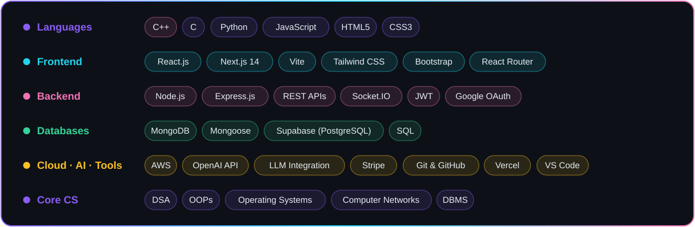

 

  

## 👩‍💻 About

  

## 🚀 Featured Projects

<table align="center">
  <tr>
    <td width="50%" align="center">
      
       
      
      
    </td>
    <td width="50%" align="center">
      
       
      
      
    </td>
  </tr>
  <tr>
    <td width="50%" align="center">
      
       
      
      
    </td>
    <td width="50%" align="center">
      
       
      
      
    </td>
  </tr>
</table>

## 🛠️ Tech Arsenal

  
    
  

## 🏆 Highlights

  

## 📊 GitHub Analytics

### 🐍 Contribution Snake

<picture>
  <source media="(prefers-color-scheme: dark)" srcset="https://raw.githubusercontent.com/TanyaVaish-17/TanyaVaish-17/output/github-snake-dark.svg"/>
  <source media="(prefers-color-scheme: light)" srcset="https://raw.githubusercontent.com/TanyaVaish-17/TanyaVaish-17/output/github-snake.svg"/>
  
</picture>

## 🤝 Let's Connect

  

