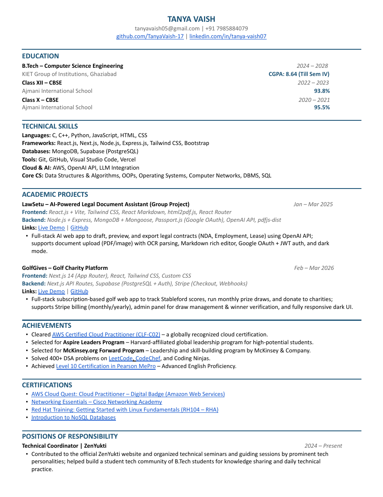

 

<a href="#about">About</a> &nbsp;·&nbsp; <a href="#projects">Projects</a> &nbsp;·&nbsp; <a href="#technical-skills">Skills</a> &nbsp;·&nbsp; <a href="#highlights">Highlights</a> &nbsp;·&nbsp; <a href="#resume">Resume</a> &nbsp;·&nbsp; <a href="#github-activity">Activity</a> &nbsp;·&nbsp; <a href="#contact">Contact</a>

## About

## Projects

<a href="https://kisan-sathi-bay.vercel.app/">Live Demo ↗</a> &nbsp;·&nbsp; <a href="https://github.com/TanyaVaish-17/KisanSathi">Source Code ↗</a>

 

<a href="https://orca-teal-nine.vercel.app/">Live Demo ↗</a> &nbsp;·&nbsp; <a href="https://github.com/TanyaVaish-17/ORCA">Source Code ↗</a>

 

<a href="https://law-setu.vercel.app">Live Demo ↗</a> &nbsp;·&nbsp; <a href="https://github.com/TanyaVaish-17/LawSetu">Source Code ↗</a>

 

<a href="https://k-click-booth.vercel.app/">Live Demo ↗</a> &nbsp;·&nbsp; <a href="https://github.com/TanyaVaish-17/photo-booth">Source Code ↗</a>

## Technical Skills

## Highlights

## Resume

<a href="./resume/Tanya_Vaish_Resume.pdf">View Resume ↗</a> &nbsp;·&nbsp; <a href="https://github.com/TanyaVaish-17/TanyaVaish-17/raw/main/resume/Tanya_Vaish_Resume.pdf">Download PDF ↓</a>

## GitHub Activity

## Contact

<a href="https://www.linkedin.com/in/tanya-vaish07/">LinkedIn ↗</a> &nbsp;·&nbsp; <a href="mailto:tanyavaish05@gmail.com">tanyavaish05@gmail.com</a> &nbsp;·&nbsp; <a href="https://github.com/TanyaVaish-17">GitHub ↗</a>

